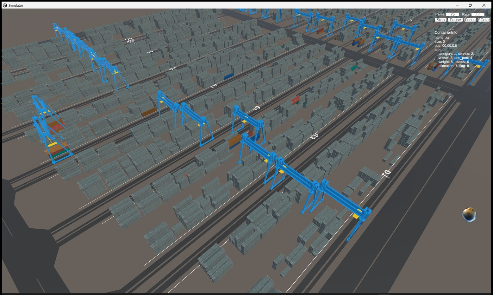

<h1 align="center">Port SLAP Simulator</h1>

<p align="center">
  A research simulator for container storage location assignment and yard scheduling.
</p>

<p align="center">
  
  
  
</p>

<p align="center">
  
</p>

Port SLAP Simulator models container arrivals, yard capacity, candidate storage
positions, placement actions, and allocation rewards. It supports rule-based,
optimization-based, and learning-based storage-location assignment policies.
Simulation results can be exported to an offline Unity Viewer or streamed to the
Viewer through the published gRPC/Protobuf interface.

We publish the Python simulator, baseline algorithms, protocol, synthetic
examples, data-export tools, tests, and Docker setup in this repository. We
distribute the compiled Viewer separately and do not publish its Unity source.

## What is included

```text
src/port_slap/simulation/       Simulator, database model, observations and rewards
src/port_slap/algorithms/       Simulated-annealing and MIP baselines
src/port_slap/visualization/    Offline exporter and online gRPC server
proto/port_slap/v1/             Stable Viewer protocol
configs/                        Runnable example configuration
examples/synthetic_data/        Deterministic non-operational port data
viewer/data/sample/             Full reference-layout demo with random metadata
viewer/data/minimal/            Small protobuf files generated from public JSON
viewer/                         Viewer access and data-placement instructions
tests/                          Unit and MySQL integration tests
docker/                         Reproducible application image
```

## Quick start: simulator

Python 3.10 or 3.11 is tested. The bundled constraints file pins the known-good
direct dependency versions used by CI and Docker.

```bash
git clone https://github.com/pwhjy/Port_SLAP_Simulator.git
cd Port_SLAP_Simulator

python -m venv .venv
source .venv/bin/activate
python -m pip install --upgrade pip
python -m pip install -c constraints.txt -e .
```

On Windows, activate the environment with:

```powershell
.venv\Scripts\activate
```

Start the example MySQL database and run a complete episode:

```bash
cp .env.example .env
docker compose up -d mysql
python scripts/generate_synthetic_data.py
python examples/random_policy.py
```

The bundled example allocates 12 arriving synthetic containers. Stop the
database with `docker compose down`; add `-v` if the demo volume should also be
removed.

## Python API

```python
from pathlib import Path

from port_slap import make

env = make(
    "PortSLAP-v0",
    config_path=str(Path("configs/example.ini").resolve()),
    reInit=True,
    dump_on_init=False,
)

try:
    state = env.reset()
    done = state["cur_container"] is None
    while not done:
        action = env.sample_random_action(state["cur_container"])
        state, reward_high, reward_low, done, metrics = env.step(action)
finally:
    env.close()
```

Each state contains the current container, candidate blocks, and candidate
slots. An action selects `(block, bay, stack, tier)` for that container.

## Unity Viewer

We provide the compiled Viewer on request for noncommercial research,
education, and evaluation. To request a build, email us at
[panweihang@zju.edu.cn](mailto:panweihang@zju.edu.cn) with your name,
affiliation, intended use, target operating system, and whether you need the
offline or online Viewer. After approval, we will reply with a download link,
package version, and SHA-256 checksum.

The downloaded archive must be extracted as a whole; `Simulator.exe` cannot
run without its accompanying `Simulator_Data`, `UnityPlayer.dll`, and runtime
directories.

We do not publish the Unity source project. We expose the integration boundary
through the versioned protocol under `proto/port_slap/v1` and the JSON/protobuf
data contract documented under `viewer/data`.

### Offline playback

Install the Viewer extra and regenerate the small, fully synthetic authoring
example:

```bash
python -m pip install -c constraints.txt -e '.[viewer]'
port-slap-viewer-export \
  --dataset examples/synthetic_data/viewer_dataset.json \
  --output viewer/data/minimal
```

`viewer/data/sample` is the ready-to-run full reference-layout demonstration.
It preserves our Viewer's spatial layout while replacing all
container identifiers and business attributes with deterministic random data.

Copy these files into the extracted Viewer's `PersistentData` directory:

```text
load_port_req.pb
load_containers_req.pb
schedule_containers_req.pb
```

Then start `Simulator.exe` and select **Play**.

### Online playback

Our online Viewer connects to `127.0.0.1:9007` by default:

```bash
port-slap-viewer-server --data-dir viewer/data/sample
```

Start the online Viewer and select **Play**. It loads the initial containers,
pulls schedule frames, and stops after the synthetic `finalcon` sentinel.

See [viewer/README.md](viewer/README.md) for the full workflow and
[viewer/ACCESS.md](viewer/ACCESS.md) for access and compatibility information.

## Example data policy

The simulator CSV files and the small JSON Viewer example are generated without
reading operational records. Their identifiers, timestamps, labels, locations,
and geometry are fully synthetic.

For the ready-to-run sample under `viewer/data/sample`, we retain the yard
calibration, container sizes/positions, and schedule frame structure from our
Viewer reference demonstration so the compiled client displays its intended
scene. We replace every container identifier and business attribute with
deterministic random values. We do not publish the source protobuf files or an
identifier mapping. The retained reference layout is approved for publication.

Regenerate the fully synthetic files with:

```bash
python scripts/generate_synthetic_data.py
port-slap-viewer-export --output viewer/data/minimal
```

We rebuild the reference-layout sample from a private local copy with:

```bash
python scripts/sanitize_viewer_protobuf.py \
  --source-dir /path/to/reference/PersistentData \
  --output-dir viewer/data/sample
```

The accepted schemas and field meanings are documented in
[examples/synthetic_data/README.md](examples/synthetic_data/README.md) and
[viewer/data/README.md](viewer/data/README.md).

## Baseline algorithms

`src/port_slap/algorithms/baseline` contains simulated-annealing and MIP
implementations. Gurobi and CPLEX require separately installed commercial
solvers and licenses. The open-source OR-Tools backend can be installed with:

```bash
python -m pip install -c constraints.txt -e '.[ortools]'
```

Run the deterministic examples without starting MySQL:

```bash
python examples/sa_baseline.py
python examples/mip_baseline.py
```

See [docs/baselines.md](docs/baselines.md) for the baseline input contract and
the database-backed integration workflow.

## Docker

Build the reusable application image:

```bash
docker compose build simulator-demo viewer-server
```

Run the complete simulator demo in containers:

```bash
docker compose --profile demo up --build \
  --abort-on-container-exit --exit-code-from simulator-demo simulator-demo
```

Run the Viewer gRPC server in Docker:

```bash
docker compose --profile viewer up --build viewer-server
```

Compose binds MySQL and gRPC to `127.0.0.1` by default. Change the published
ports deliberately if another machine needs to connect; neither demo service
provides production authentication.

## Tests

```bash
python -m pip install -c constraints.txt -e '.[viewer,dev]'
pytest -m "not integration"
```

With the Compose MySQL service running:

```bash
PORT_SLAP_RUN_INTEGRATION=1 pytest -m integration
```

## License

We publish this repository under the
[PolyForm Noncommercial License 1.0.0](LICENSE). The license permits research,
education, personal study, and other noncommercial uses, but it is not an
OSI-approved open-source license. The accurate description is therefore
**source-available for noncommercial use**. Contact us before commercial use.

## Citation

Citation metadata is provided in [CITATION.cff](CITATION.cff).

## Joint Development

Port SLAP Simulator is jointly developed by
[ZJULearning](https://github.com/ZJULearning) and
[FABU](https://www.fabu.ai/) (Hangzhou FABU Technology Co., Ltd.).
